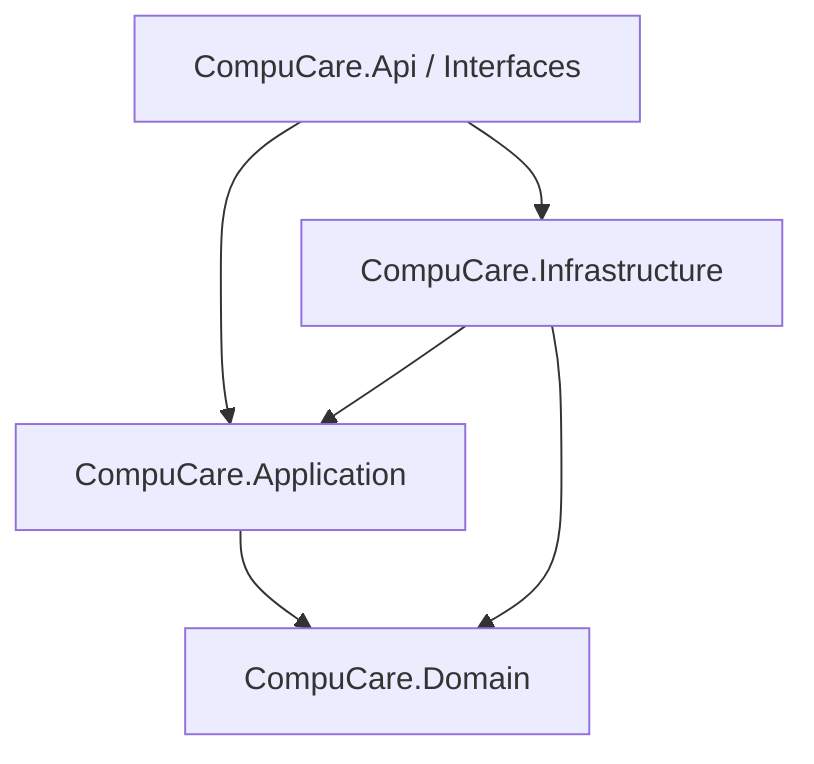

# Arquitectura DDD de CompuCare

La solución utiliza un **modular monolith** con fronteras de BC explícitas. El dominio no depende de infraestructura, HTTP ni EF Core.

## Clasificación estratégica

1. **Core:** BC04 Service Requests, BC03 Subscriptions and Coverage.
2. **Supporting:** BC02 Companies and Equipment, BC05 Quotations and Payments.
3. **Generic:** BC01 Identity and Access.

## Dirección de dependencias

**Domain:** Aggregates, Entities, Value Objects, Domain Events, políticas e invariantes sin dependencias de otros proyectos.

**Application:** Commands, Queries, Handlers, interfaces de repositorios, servicios y contratos de lectura. Validación de pertenencia y transacciones cruzadas.

**Infrastructure:** EF Core, PostgreSQL, repositorios, autenticación/Identity, servicios externos. Implementa puertos de Application.

**Interfaces:** Controllers/Minimal APIs, contratos HTTP, middleware, composición e inyección de dependencias.

## Context Map preliminar

- BC04 depende de BC02 para confirmar que el usuario y el equipo pertenecen a la misma empresa.
- BC04 pide a BC01 identidad y permisos mediante abstracciones de Application.
- BC04 comunica el consumo de horas a BC03 con protección contra reintentos.
- BC04 consulta el estado de las cotizaciones de BC05 para impedir cierres indebidos.
- BC05 solo acepta aprobación de responsables de la empresa correcta.

No navegar directamente entre agregados internos de distintos Bounded Contexts. Compartir identificadores y contratos explícitos. La orquestación entre agregados pertenece a Application o a mecanismos de eventos de integración.

## Estado actual del starter

El agregado BC04 ServiceRequest y sus invariantes están implementados como ejemplo verificable por pruebas unitarias. Los demás agregados incluyen **estructuras iniciales** y deben enriquecerse antes de su uso en casos de negocio. La base de datos está mapeada, pero **no hay migraciones generadas** ni endpoints empresariales publicados.
